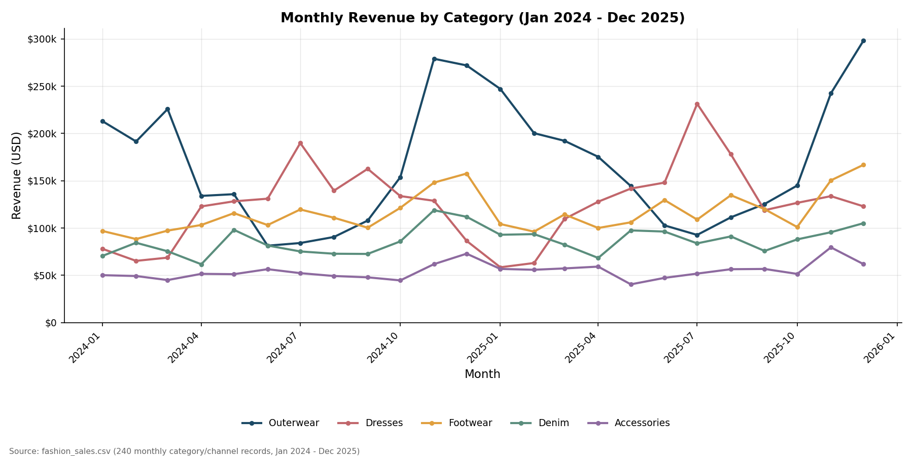
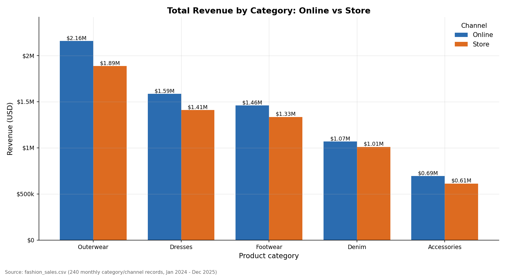
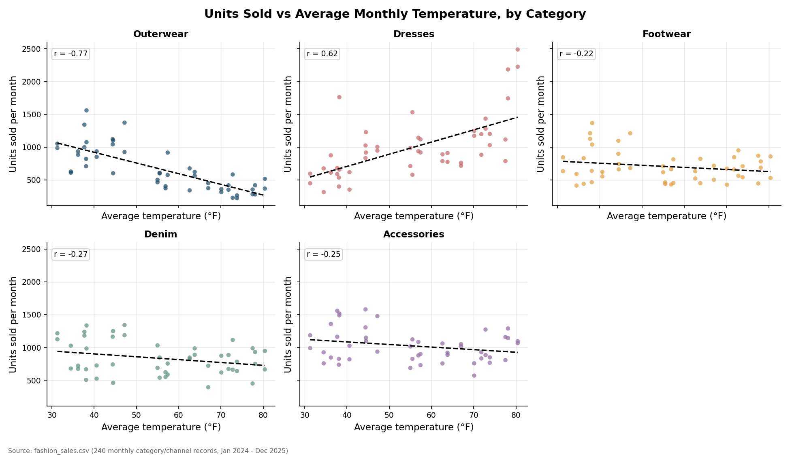
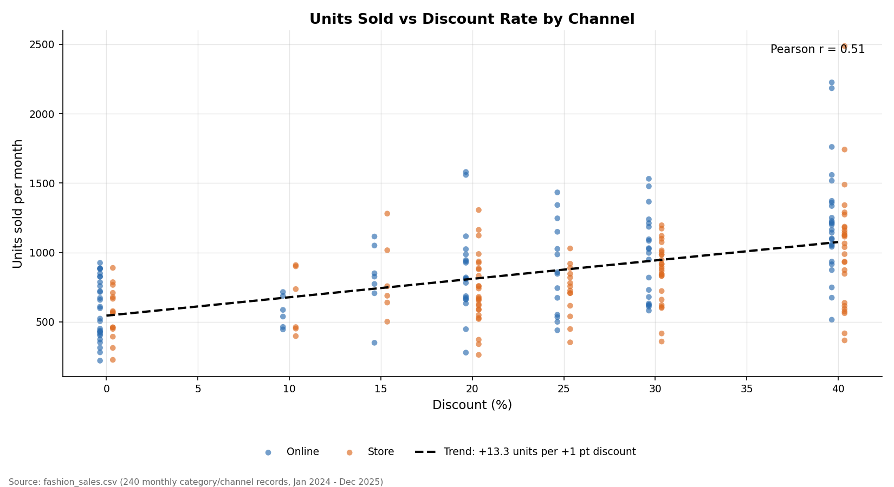
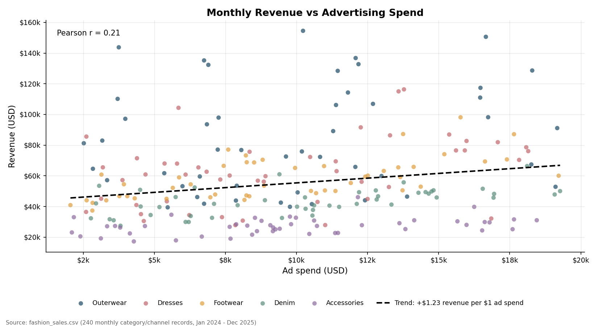
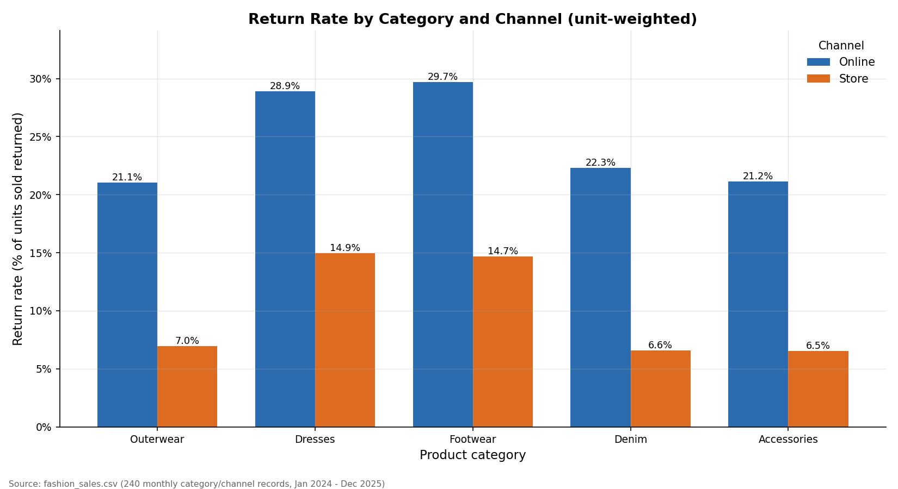

# Fashion Sales Dataset — Structure, Quality and Full Analysis

**File:** `fashion_sales.csv` · **Rows:** 240 · **Columns:** 14 · **Period:** January 2024 – December 2025
**Totals:** $13,220,482 revenue · 202,500 units · $2,337,530 ad spend · 35,642 returned units

---

## 1. What the dataset covers

This is a **monthly sales summary for a fashion retailer**, broken down by product category and sales channel. It contains no customer-level, order-level or product-level records — each row is already an aggregate for one month, one category and one channel.

Five categories: **Dresses, Denim, Outerwear, Footwear, Accessories**.
Two channels: **Online and Store**.
24 months: **2024-01 through 2025-12**.

## 2. How it is organized

| Property | Value |
|---|---|
| Grain | one row = one month × category × channel |
| Primary key | `(month, category, channel)` — unique, no duplicates |
| Grid | 24 months × 5 categories × 2 channels = **240 rows**, fully balanced |
| Rows per month | exactly 10 (every category × channel pair) |
| Missing values | **none** — every cell populated in all 14 columns |
| Sort order | chronological, one month block at a time |
| Coverage | Jan 2024 – Dec 2025, no gaps |

Because the panel is perfectly balanced, any month, category or channel subtotal is directly comparable with any other — there is no missing-period distortion to adjust for.

### Column dictionary

| Column | Type / precision | Range | What it is |
|---|---|---|---|
| `month` | text `YYYY-MM` | 2024-01 … 2025-12 | reporting month label |
| `year` | integer | 2024, 2025 | year (redundant with `month`) |
| `month_num` | integer | 1–12 | calendar month number (redundant with `month`) |
| `category` | text | 5 values | product category |
| `channel` | text | Online, Store | sales channel |
| `avg_temp_F` | 1 decimal | 31.3 – 80.4 | **month-level** average temperature, °F |
| `list_price` | integer | 35 / 70 / 85 / 110 / 180 | **category-level** regular price, USD |
| `discount_pct` | integer | 0, 10, 15, 20, 25, 30, 40 | stated discount, % |
| `sale_price` | 2 decimals | 19.57 – 197.18 | realized average selling price, USD |
| `ad_spend` | multiple of 10 | 2,050 – 19,270 | marketing spend for that category/channel/month, USD |
| `avg_rating` | 1 decimal | 3.4 – 5.0 | average customer rating |
| `units_sold` | integer | 220 – 2,488 | units sold |
| `revenue` | 2 decimals | 17,257.20 – 154,512.49 | revenue, USD |
| `return_rate` | proportion, ≤3 dp | 0.010 – 0.356 | share of units returned |

## 3. How the columns depend on each other

The dataset has three distinct dependency layers:

**a) Derived identifiers.** `year` and `month_num` are simply parsed from `month`. They agree in all 240 rows.

**b) A revenue identity.** `revenue = units_sold × sale_price` **exactly**, to the cent, in **all 240 rows**. This is the one hard accounting relationship in the file and it is perfectly consistent. Any analysis of revenue is therefore equivalent to an analysis of units × realized price.

**c) Prices that do *not* reconcile.** One would expect `sale_price = list_price × (1 − discount_pct/100)`. It never is:

- only **21 of 240 rows** are within ±1% of that formula, and only 114 within ±5%;
- deviations run from **−9.8% to +9.9%** around the expected price;
- median absolute difference is **$3.26**, maximum **$17.18**;
- **43 rows have `discount_pct = 0`**, yet every one of them has `sale_price ≠ list_price`;
- **21 rows sell above list price** (e.g. 2024-09 Outerwear Online: list $180, 0% discount, sale $197.18).

So `sale_price` behaves like a price with ±10% noise around the formula rather than a deterministic calculation. `revenue` remains trustworthy because it is consistent with `sale_price`, but any *derived* discount should not be recomputed from prices — use `discount_pct` as the stated discount and treat `sale_price` as the realized price. Aggregate implied discount averages 22.7% vs stated 22.6%, so the noise is symmetric, not a systematic bias.

**d) Repeating attributes.**

- `avg_temp_F` takes exactly **24 distinct values — one per month** — and is repeated on all 10 rows of that month. It is a month-level variable, not a cell-level one.
- `list_price` takes exactly **5 distinct values — one per category** — and never changes across 24 months. Prices are static in this dataset.
- `discount_pct` takes only **7 values** (0, 10, 15, 20, 25, 30, 40).

Everything else — `ad_spend`, `avg_rating`, `units_sold`, `return_rate` — varies independently per row.

## 4. What is surprising

1. **There are zero missing values and zero duplicates in a perfectly balanced 240-cell grid.** Real retail extracts almost never look this clean.
2. **Prices never change per category over two years** — `list_price` is fixed at $35/$70/$85/$110/$180. There is no inflation, promotion calendar or repricing in the data.
3. **`sale_price` is inconsistent with `list_price` and `discount_pct` in 240/240 rows**, and 21 rows sell above list price at 0% discount. This looks like simulated noise, not a real pricing process.
4. **Discounts increase units but not revenue** (Section 5.4): +16% units per 10 discount points, but a revenue effect that is statistically indistinguishable from zero.
5. **Ad spend is almost flat across categories** ($9.4K–$10.2K mean) even though category revenue differs by 3× and ad efficiency differs by 4× ($0.44 vs $1.77 revenue per ad dollar).
6. **Return rate is nearly deterministic**: channel, category and rating explain **95.1%** of its variation (Section 5.6). Real return behaviour is never that predictable.
7. **Temperature is perfectly confounded with calendar month** — there are only 24 distinct temperature values, one per month, so weather and season cannot be separated.
8. **Revenue per unit is constant across the two years** ($65.57 → $65.02) despite large shifts in category mix and discounting, because discounts move volume almost exactly enough to offset price.

---

## 5. Full analysis

**Method.** Pearson correlations with p-values; OLS regressions with category and/or month fixed effects where confounding matters. Temperature is analysed at **category-month level (n = 24)** because it repeats across channels. Charts referenced below live in `charts/`.

### 5.1 Seasonality

| Category | CV of monthly revenue | Peak | Trough | Peak/trough | Share of revenue Dec–Feb | Jun–Aug |
|---|---:|---|---|---:|---:|---:|
| Outerwear | 0.40 | 2025-12 · $298,278 | 2024-06 · $81,290 | **3.67×** | **35.2%** | 13.9% |
| Dresses | 0.33 | 2025-07 · $231,398 | 2025-01 · $58,455 | **3.96×** | 15.8% | **34.0%** |
| Footwear | 0.18 | 2025-12 · $166,873 | 2024-02 · $88,334 | 1.89× | 25.4% | 25.3% |
| Denim | 0.16 | 2024-11 · $118,810 | 2024-04 · $61,659 | 1.93× | 26.9% | 24.1% |
| Accessories | 0.16 | 2025-11 · $79,538 | 2025-05 · $40,412 | 1.97× | 26.5% | 24.0% |

- Outerwear and Dresses are the seasonal pair, and they move **against** each other: monthly revenue correlation **r = −0.62** across 24 months.
- Total monthly revenue ranges **$453,369 – $754,943** (CV 0.15). The category offset keeps the company total far steadier than any single category.
- **Nov–Dec is the peak**: averages of $719K and $728K vs **$516K** in the other ten months (**+40%**). June is the trough ($489K); the calendar-month max/min ratio is **1.49×**.
- Other category pairs move together (Footwear–Denim r = +0.68, Footwear–Accessories r = +0.65), suggesting a shared demand driver such as general shopping activity.
- Returns are **not** seasonal: monthly return rates stay within 16.5%–19.2% and show no significant trend (r = 0.35, p = 0.26).

**The month that stands out: December 2025.** It is the highest point on every time-series chart and the record month in the file:

| Metric | Dec 2025 | Benchmark |
|---|---:|---:|
| Revenue | **$754,943** | $516,333 average non-Nov/Dec month (+46%) |
| Units | **12,778** | 7,838 average non-Nov/Dec month (+63%) |
| Outerwear revenue | $298,278 | +77% vs its own monthly average |
| Footwear revenue | $166,873 | +43% vs its own monthly average |
| Average discount | **35.0%** | highest of all 24 months (overall 22.6%) |
| Return rate | 19.34% | essentially tied with Jul 2025 for the highest of the 24 months |
| Revenue per unit | $59.08 | $65.29 overall (−9.5%) |
| Ad spend | $107,840 | ~10% above the non-holiday average ($98,285) |

The spike is **weather + holiday demand, amplified by discounting**, not advertising: 38.2°F, Nov–Dec pair averages of $719K–$728K vs $516K elsewhere, and Outerwear/Footwear doing the lifting while Dresses is flat (−2%). It is also a **lower-quality revenue month** — the deepest discounting and near-record returns mean each dollar of December revenue carried more volume and less margin. The second-tallest month is Nov 2024 ($736,471) for the same reason; the mirror image is Jun 2024 ($453,369, with Outerwear at just $81,290).

### 5.2 2024 vs 2025

| Metric | 2024 | 2025 | Change |
|---|---:|---:|---:|
| Revenue | $6,406,734 | $6,813,748 | **+6.4%** |
| Units | 97,712 | 104,788 | **+7.2%** |
| Revenue per unit | $65.57 | $65.02 | −0.8% |
| Ad spend | $1,098,180 | $1,239,350 | **+12.9%** |
| Ad spend / revenue | 17.1% | 18.2% | +1.1 pts |
| Return rate | 17.2% | 17.9% | +0.7 pts |
| Rating (unit-weighted) | 4.26 | 4.21 | −0.05 |
| Mean discount | 22.9% | 22.3% | −0.6 pts |

- Growth is consistent, not one lucky month: **42 of 60 matched month×category pairs grew (70%)**, median **+9.9%**, one-sample t-test p = 0.0004.
- **Online grew +10.0%** ($3.32M → $3.65M); **stores grew +2.4%** ($3.09M → $3.16M). Online is now 52.7% of revenue.
- All categories grew: Dresses +8.7%, Accessories +6.7%, Denim +6.1%, Outerwear +5.5%, Footwear +5.1%.
- Growth came with efficiency loss: ad spend rose 12.9% against 6.4% revenue growth; Outerwear returns rose 13.7% → 15.1% and Denim 14.0% → 15.4%; ratings fell in both channels (Online 4.19 → 4.14, Store 4.34 → 4.28).
- December 2025 set the record at **$754,943** vs $700,719 a year earlier.

### 5.3 Temperature effects by category

Units vs average monthly temperature, category-month level (n = 24):

| Category | r (units, temp) | p | Slope | r (revenue, temp) |
|---|---:|---:|---:|---:|
| Outerwear | **−0.82** | <0.001 | **−32.6 units per +1°F** | −0.89 |
| Dresses | **+0.68** | 0.0003 | **+37.2 units per +1°F** | +0.85 |
| Footwear | −0.26 | 0.22 | −6.4 | −0.07 |
| Denim | −0.35 | 0.10 | −8.7 | −0.30 |
| Accessories | −0.30 | 0.16 | −7.8 | −0.34 |

- A 10°F warmer month is associated with ~**326 fewer Outerwear units** and ~**372 more Dresses units**. Temperature explains 67% of Outerwear's monthly unit variance and 46% of Dresses'.
- The other three categories show no statistically significant response.
- **Caveat:** temperature has exactly 24 distinct values, one per month, so it is collinear with calendar month. These are seasonal effects; "weather" and "time of year" cannot be separated.

### 5.4 Do bigger discounts sell more units?

| Discount | Mean units | Median units | n |
|---|---:|---:|---:|
| 0% | 586 | 577 | 43 |
| 10% | 607 | 562 | 12 |
| 15% | 812 | 773 | 13 |
| 20% | 784 | 755 | 45 |
| 25% | 802 | 768 | 28 |
| 30% | 911 | 916 | 46 |
| 40% | **1,129** | **1,124** | 53 |

- Overall **r(discount, units) = +0.51**; within every category +0.55 to +0.75 (Denim +0.75, Footwear +0.69), all p < 0.001.
- OLS with category + month fixed effects: **+11.3 units per discount point** (p = 2×10⁻¹³), i.e. **+16.1% units per +10 points** (p = 2×10⁻¹⁶). Units-price elasticity is **−1.20** (p = 1×10⁻¹⁹).
- **Revenue does not follow.** The same FE model estimates **+$166 revenue per discount point (p = 0.13)**, about +$1,700 (+3%) for 10 extra points, not significant. Revenue-price elasticity is −0.20.
- Within-category 0% → 40% comparisons: Outerwear 378 → 906 units, Dresses 667 → 1,465, Denim 563 → 1,092, Footwear 479 → 953, Accessories 810 → 1,220.
- Discounts are **unrelated to returns**: r = −0.10 (p = 0.11), FE coefficient ≈ 0 (p = 0.46), within-channel r = +0.01 / −0.06.
- Online discounts average 21.1% vs 24.0% in stores.

**Interpretation:** discounting is an effective volume lever but a neutral-to-negative revenue lever, and without margin data it is the most likely source of margin erosion.

### 5.5 Does ad spending pay off?

| Category | Mean ad spend | Ad / revenue | r(ad, revenue) | Marginal $ revenue per $1 ad |
|---|---:|---:|---:|---:|
| Outerwear | $9,894 | **11.7%** | +0.18 | $1.35 (p = 0.22) |
| Dresses | $9,502 | 15.2% | +0.37 | $1.74 (p = 0.009) |
| Footwear | $9,418 | 16.2% | **+0.61** | **$1.77** (p < 0.001) |
| Denim | $10,190 | 23.5% | +0.56 | $1.01 (p < 0.001) |
| Accessories | $9,695 | **35.6%** | +0.38 | **$0.44** (p = 0.008) |

- Overall r(ad, revenue) = **+0.21** (p = 0.001); ad spend alone explains only **R² = 0.043**.
- With category + month FE: **+$1.36 revenue per +$1 ad spend** (p = 3×10⁻⁷); log-log elasticity **+0.19** (p = 1×10⁻⁸).
- The **average** cell returns **$7.25 revenue per ad dollar** (median $5.53). The marginal dollar returns far less (~$1.36), consistent with diminishing returns and with a budget spread evenly across cells of very different yield.
- No carryover: this month's ad spend vs **next** month's revenue gives **r = −0.03, p = 0.76**.
- Spend is uncorrelated with price tier (r with `list_price` = 0.00), discount (r = −0.00), temperature (r = +0.04) and month (r = +0.11, p = 0.08) — it looks close to randomly assigned within the panel, which makes the within-month comparisons below more credible.
- **The naive per-category slopes above are confounded by seasonality** (ads and revenue both peak in Nov–Dec). Comparing cells within the same month removes that:

| Category | Naive $ per $1 | Within-month $ per $1 | Elasticity (log-log) | Ad/revenue | Avg revenue per ad $ | Net of returns per $1 |
|---|---:|---:|---:|---:|---:|---:|
| Outerwear | $1.35 (p = 0.22) | **$2.27** | 0.23 | **11.7%** | **$8.52** | **$1.94** |
| Footwear | $1.77 | $1.68 | 0.22 | 16.2% | $6.18 | $1.30 |
| Dresses | $1.74 | $1.31 | 0.16 | 15.2% | $6.57 | $1.02 |
| Denim | $1.01 | $1.23 | 0.25 | 23.5% | $4.25 | $1.05 |
| Accessories | $0.44 | **$0.54** | 0.17 | **35.6%** | $2.81 | **$0.46** |

- **Recommendation:** grow **Outerwear** first — best within-month marginal return ($2.27), lowest ad intensity (11.7% of revenue), best average efficiency ($8.52 revenue per ad dollar) and best unit economics ($126.81/unit, 14.4% returns). Because its demand is strongly weather-driven (revenue–temperature r = −0.89), weight the extra spend toward Sep–Dec instead of spreading it across the year.
- **Footwear** is the most robust second choice: $1.68–$1.77 per $1 in both specifications, and much less seasonal (CV 0.18). Its 22.4% return rate trims the net figure to ~$1.30.
- **Fund it from Accessories**: $0.54 per $1 (lowest in both specifications), 35.6% of revenue already going to ads, and only ~$0.46 net of returns. Moving 20% of its ~$465K annual budget (~$93K) to Outerwear is associated with roughly **+$85K to +$161K revenue** (0.6–1.2% of annual revenue) depending on specification.
- Elasticities across categories are similar (0.16–0.25) and not statistically distinguishable (interaction p > 0.7); the differences in dollar returns come mainly from revenue-per-ad-dollar levels, not from different response rates.
- Revenue ROI is not profit ROI: with no COGS, break-even cannot be computed, but $1.36 revenue per ad dollar is thin for apparel. The estimates are associational, identified mainly from Online-vs-Store differences, and should be validated with a holdout test before scaling total budget.

### 5.6 What is related to returns?

| Driver | Effect on return rate | p |
|---|---:|---:|
| Online (vs Store) | **+14.1 pts** | 3×10⁻¹³³ |
| Dresses (vs Accessories) | **+7.9 pts** | 8×10⁻⁵² |
| Footwear (vs Accessories) | **+8.3 pts** | 5×10⁻⁵⁵ |
| Denim / Outerwear (vs Accessories) | +0.3 / +0.1 pts | ns |
| `avg_rating`, per +1.0 | **−4.4 pts** | 2×10⁻¹⁸ |
| `discount_pct` | ~0 | 0.46 |
| `ad_spend`, `units_sold`, `avg_temp_F` | jointly nothing (F-test) | 0.65 |

- Weighted overall return rate **17.6%** — **35,642 of 202,500 units** returned.
- **Online 24.6% vs Store 9.9%** (t = 25.0, p = 1×10⁻⁶⁸). The gap holds in every category: Footwear 29.7% vs 14.7%, Dresses 28.9% vs 14.9%, Denim 22.3% vs 6.6%, Accessories 21.2% vs 6.5%, Outerwear 21.1% vs 7.0%.
- Model fit: channel alone **R² = 0.725**; + category **0.931**; + rating **0.951**. Adding ad spend, units, discount and temperature raises R² to 0.9511 (F-test p = 0.65) — nothing.
- The rating link survives composition controls: partial r(return, rating | channel, category) = **−0.53** (p = 7×10⁻¹⁹).
- **Return concentration:** Dresses account for **30.0%** of returned units on 22.7% of revenue; Footwear 21.2%; Accessories **19.4%** of returns on only 9.9% of revenue. Outerwear produces just **12.9%** of returns on 30.6% of revenue.

### 5.7 What is related to ratings?

- Simple mean **4.22**, median 4.20, range 3.4–5.0; unit-weighted 4.23.
- **No category differences** (ANOVA F = 0.42, p = 0.79). The 4.18–4.25 spread is noise.
- **Online 4.16 vs Store 4.31** (unit-weighted; t-test p = 0.0001; OLS gap −0.139, p = 1×10⁻⁴), and stores rate higher in all five categories (+0.10 to +0.16).
- Unrelated to discount (r = −0.01, p = 0.85), list price (r = −0.01, p = 0.90), temperature (r = 0.00), ad spend (r = −0.08, p = 0.19); weakly related to units (r = +0.13, p = 0.04).
- The only strong relationship is with returns: **r = −0.35** raw and **−0.53** within channel/category.
- Ratings show no seasonality (monthly means 4.15–4.35).

---

## 6. Bottom line

1. **Seasonality is the dominant pattern**, concentrated in Outerwear and Dresses, which swing 3.7–4.0× peak-to-trough and are negatively correlated (r = −0.62); the offset stabilizes total revenue. Nov–Dec adds ~40% to a normal month.
2. **2025 grew 6.4% on 7.2% more units**, almost entirely online (+10.0% vs +2.4%), but at the cost of 12.9% more ad spend, higher returns and lower ratings. Revenue per unit fell 0.8%.
3. **Discounting buys volume, not money**: +16% units per 10 points, but a revenue effect of about +3% that is not statistically significant.
4. **Ads are weakly effective**: r = 0.21, ~$1.36 marginal revenue per $1, no next-month carryover. Within-month, Outerwear ($2.27 per $1) and Footwear ($1.68) are the best uses of a marginal ad dollar; Accessories ($0.54, 35.6% of revenue) is the worst and should fund the shift.
5. **Returns are the biggest controllable leak**: 17.6% overall, 24.6% online vs 9.9% store, with 51% of returned units coming from Dresses and Footwear. Channel + category + rating explain 95% of return variation; discounts and ads are irrelevant.
6. **Ratings reveal only a channel gap** (4.16 online vs 4.31 store); category, price, discount and weather do not move them.

## 7. Method notes and limitations

- **Temperature is collinear with month** (24 unique values); temperature findings are seasonal findings.
- **No cost, margin or profit columns.** Ad ROI and discount profitability are revenue-based only.
- **`sale_price` is inconsistent with `list_price`/`discount_pct` in every row.** Revenue conclusions are safe (`revenue = units × sale_price` exactly), but price-discount analysis uses `discount_pct` directly.
- **Associations, not causation.** In particular, ad spend and revenue are jointly determined; the marginal $1.36 estimate may still overstate the causal effect.
- **Temperature p-values use category-month aggregates** to avoid pseudo-replication from repeating monthly temperature across channels.
- **Multiple comparisons**: with six analysis areas, individual p-values near 0.05 should be read as suggestive; the headline effects have p < 0.001.
- **Synthetic-data signals**: perfect balance, zero missing values, fixed list prices, ±10% price noise and a near-deterministic return formula. Findings describe this file, not necessarily the real market.

## 8. Charts and reproduction

| Chart | File |
|---|---|
| Monthly revenue by category | `charts/01_revenue_by_month_category.png` |
| Channel revenue by category | `charts/02_channel_revenue_by_category.png` |
| Units sold vs discount | `charts/03_units_vs_discount.png` |
| Units sold vs temperature by category | `charts/04_units_vs_temperature_by_category.png` |
| Revenue vs ad spend | `charts/05_revenue_vs_ad_spend.png` |
| Return rate by category and channel | `charts/06_return_rate_category_channel.png` |

Charts are regenerated with `python3 make_charts.py` (requires `matplotlib`, `pandas`, `numpy`).
